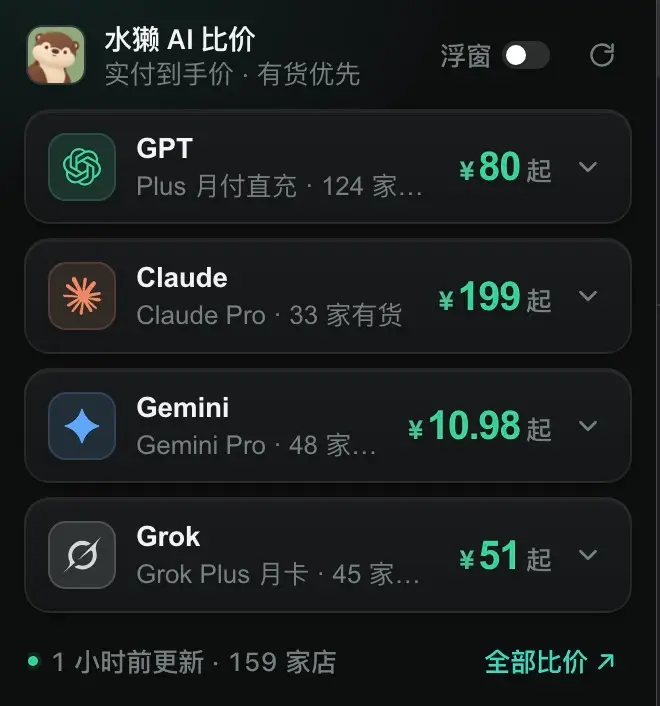

# 水獭 AI 比价浏览器扩展（shuita-extension）

面向 Chrome / Edge / Arc / Brave（Manifest V3）的轻量 AI 订阅价格查询插件，实时同步 [水獭 AI 比价（shuita.xyz）](https://shuita.xyz/) 的全网到手价。

<p>
  
</p>

## 核心功能

- **四大主力模型速览**：默认展示 **GPT / Claude / Gemini / Grok** 当前最便宜的实付到手价与有货商家数。
- **展开看前 3 家低价店**：后台自动预取当前展示的 4 个 SKU，点击卡片零等待展开前 3 名有货低价店铺与库存信息。
- **自定义常用规格**：每个模型支持在展开面板中切换并记住你常看的规格（如 `Plus 月付直充` / `Claude Pro` / `Gemini Pro` / `SuperGrok`）。
- **官网升级页克制浮窗**：仅在 ChatGPT / Claude / Gemini / Grok 官网的升级、定价或账单页右下角弹出单行毛玻璃胶囊提示最低价（普通对话页不打扰，关闭后 7 天内静默）；支持在插件顶栏通过「浮窗」开关随时全局启停。
- **一键直达主站**：点击跳转至 `https://shuita.xyz/sku/<sku>` 查看完整报价、价格走势与说明。

## 本地安装

零依赖、无需构建，直接加载即可：

1. 打开 `chrome://extensions/`（Edge 为 `edge://extensions/`）。
2. 开启右上角「开发者模式」。
3. 点击「加载已解压的扩展程序」，选择本仓库目录。

## 权限与隐私说明

本扩展不收集、不上传任何个人身份信息、浏览历史或对话内容：

- **`storage`**：仅在浏览器本地保存价格缓存（10 分钟有效期）、你选择的常用规格、浮窗总开关以及 7 天静默记录。
- **`https://shuita.xyz/*`**：由后台 Service Worker 读取公开价格行情切片（`/api/mcp/index.json` 与 `/api/mcp/sku/<sku>.json`），并内置 10 分钟缓存与 30 秒手动刷新防抖。
- **官网 `content_scripts`**：仅在指定的 4 家 AI 官网域名运行，且只在 URL 命中升级/定价/账单路由时渲染隔离的 Shadow DOM 浮窗，不读取页面表单或聊天内容。

## 本地测试

```bash
npm test
```

## 开源协议

[MIT](./LICENSE)
